

<h1 align="center">📖 סידור · נוסח עדות המזרח</h1>

<b>התפילה בכיס. מהירה, נקייה, ובלי פרסומות.</b> 
סידור חול מלא לשחרית, מנחה וערבית, ברכות, זמני היום ותזכורות. הכול באתר אחד שמותקן כמו אפליקציה.

<i>לעילוי נשמת עדי עדיאל טויטו הי״ד</i>

<a href="https://idanatwork.github.io/LPs/tefila/"><b>◀ פתחו את הסידור עכשיו</b></a>

<table dir="rtl" align="center"><tr>
<td align="center">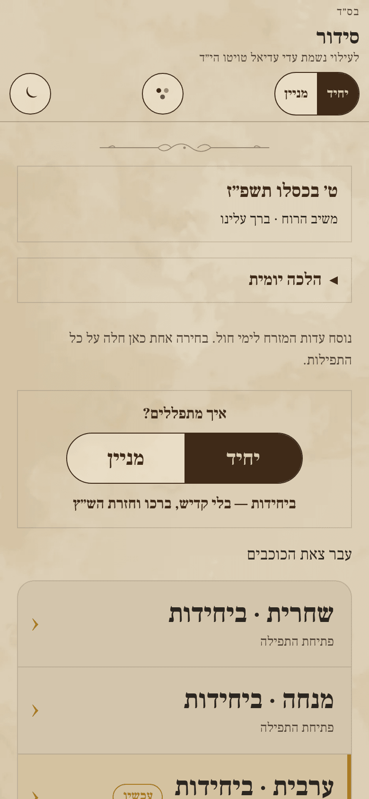</td>
<td align="center">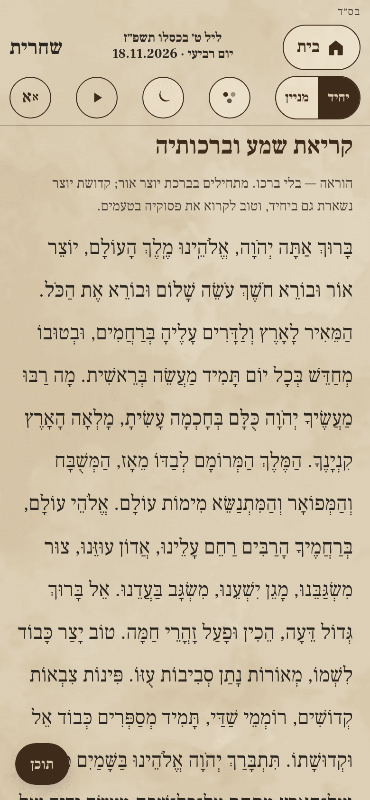</td>
<td align="center">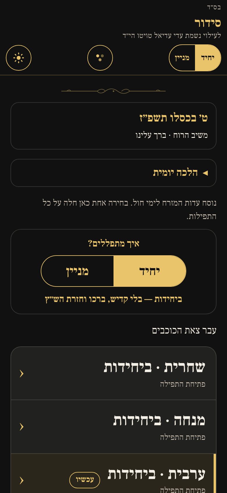</td>
</tr></table>

✅ חינם &nbsp;·&nbsp; ✅ בלי הרשמה &nbsp;·&nbsp; ✅ עובד גם בלי קליטה &nbsp;·&nbsp; ✅ אייפון ואנדרואיד

---

## מה זה?

סידור שנבנה בשביל התפילה עצמה. נוסח **עדות המזרח** לימות החול, עם הלכות וניסוחים לפי **ילקוט יוסף**. הסידור יודע איזה יום היום, ומציג רק את מה שצריך להגיד עכשיו: ראש חודש, חנוכה, תעניות, עשרת ימי תשובה, תשעה באב, שיר של יום, הלל ותחנון.

---

## מה יש בפנים

<table dir="rtl" width="100%">
<tr><td width="33%" align="center" valign="top">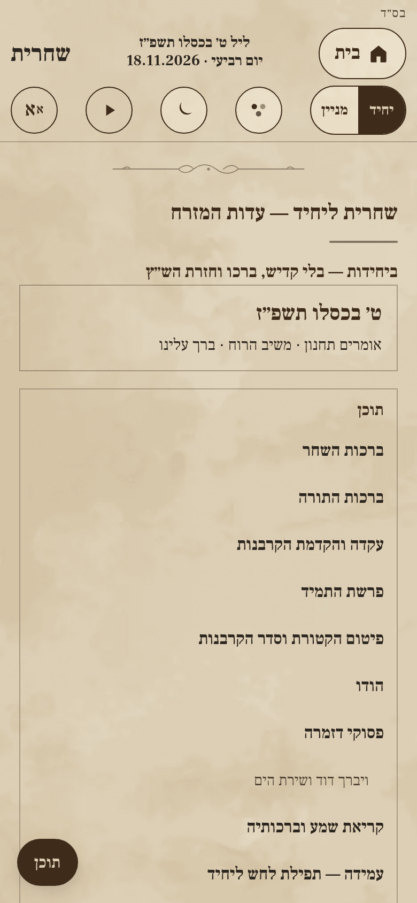  <b>🕊️ שחרית, מנחה וערבית</b> שלוש תפילות מלאות, כל אחת עם תוכן עניינים. קפיצה לכל חלק בלחיצה אחת, ולוח ניווט צף שמלווה אותך בזמן הקריאה.  בראש המסך: התאריך העברי, סטטוס היום והלכה יומית קצרה.</td><td width="33%" align="center" valign="top">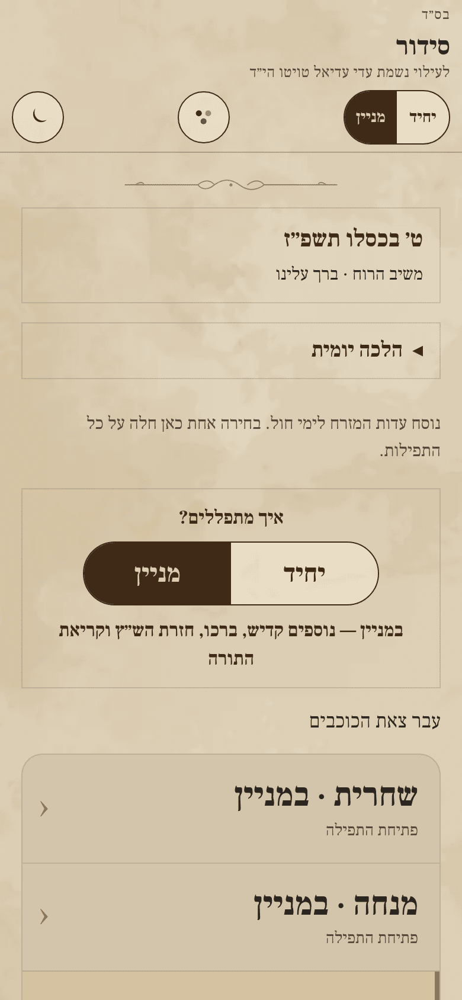  <b>👥 יחיד או מניין</b> מתג אחד משנה את כל התפילות. במצב מניין מופיעים קדיש, קדושה, ברכו וחזרת הש״ץ. ביחידות הם מוסתרים. הבחירה נשמרת.</td><td width="33%" align="center" valign="top">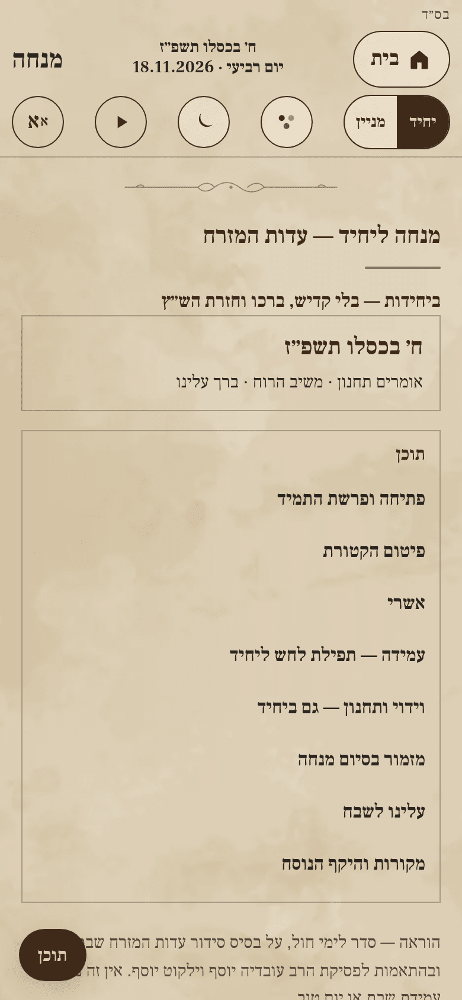  <b>🌇 כל התפילות, כל היום</b> מנחה וערבית בנוסח עדות המזרח, עם החלקים שמשתנים לפי היום. בלי לחפש ובלי לדפדף.</td></tr>
</table>

<table dir="rtl" width="100%">
<tr><td width="33%" align="center" valign="top">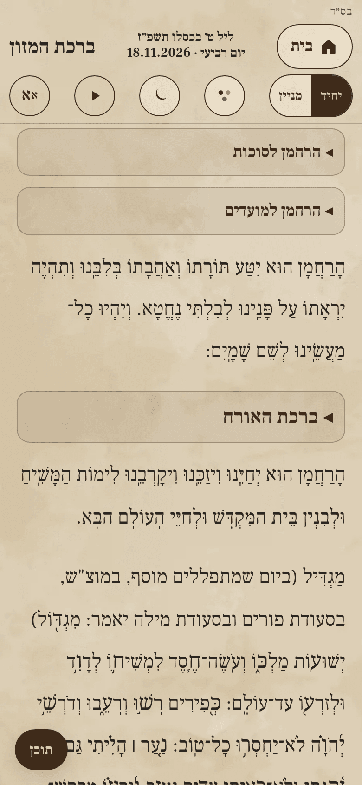  <b>🍞 ברכת המזון וברכות נוספות</b> ברכת המזון מלאה, עם ברכת האורח שנפתחת רק כשצריך. בנוסף: אשר יצר, בורא נפשות ומעין שלוש.</td><td width="33%" align="center" valign="top">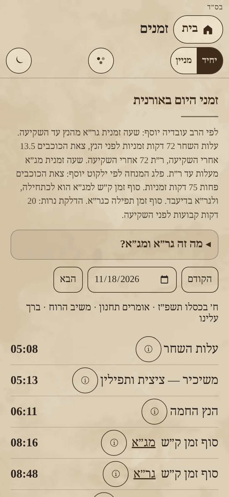  <b>⏰ זמני היום</b> זמני היום לפי פסיקת הרב עובדיה יוסף. הסבר קצר על שיטת הגר״א ושיטת המג״א מופיע בעמוד עצמו.</td><td width="33%" align="center" valign="top">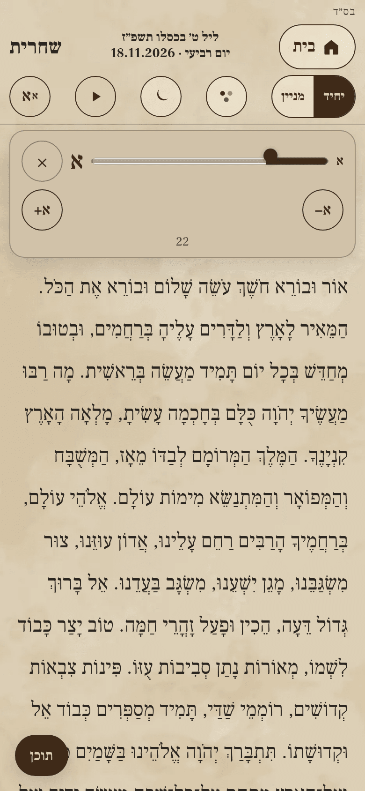  <b>🔠 קריאה נוחה</b> סרגל לגודל הכתב, מצב כהה, ושישה צבעי הדגשה: זהב, כחול, זית, בורדו, סגול וטורקיז.</td></tr>
</table>

<table dir="rtl" width="100%">
<tr><td width="33%" align="center" valign="top">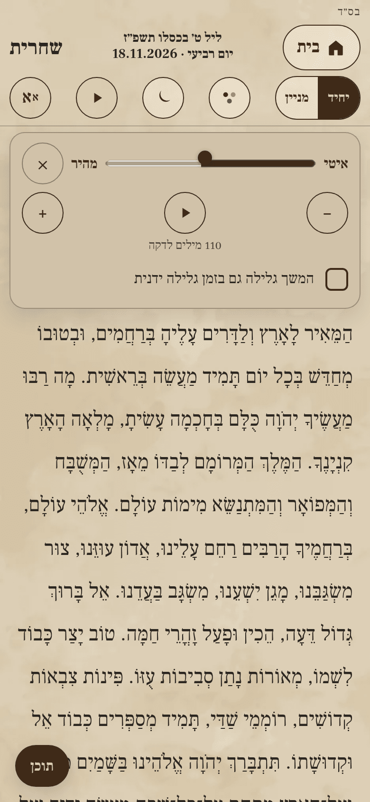  <b>📜 גלילה אוטומטית</b> הטקסט זז לבד במהירות שבחרת. אפשר להמשיך לגלול גם אחרי נגיעה במסך. הידיים פנויות.</td><td width="33%" align="center" valign="top">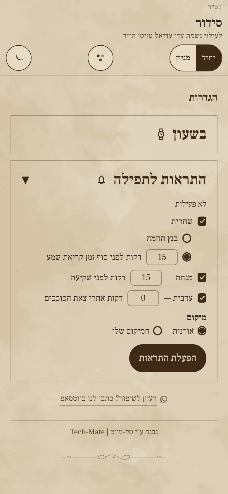  <b>🔔 תזכורות לתפילה</b> התראות לשחרית (בזריחה, או דקות לפני סוף זמן קריאת שמע), למנחה ולערבית. אפשר לבחור מיקום קבוע או "המיקום שלי" ולשלוח התראת בדיקה.  באייפון צריך קודם "הוסף למסך הבית".</td><td width="33%" align="center" valign="top">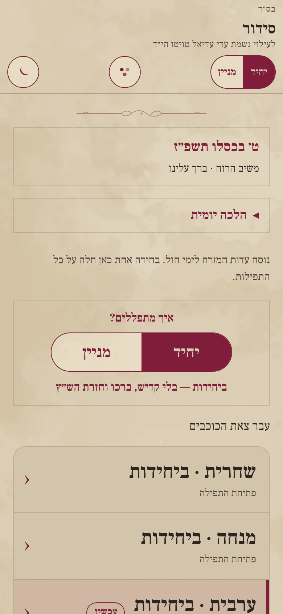  <b>🎨 עיצוב שלך</b> כל המסכים מתאימים את עצמם לצבע שבחרת. כאן: בורדו.</td></tr>
</table>

<table dir="rtl" width="100%">
<tr><td width="33%" align="center" valign="top">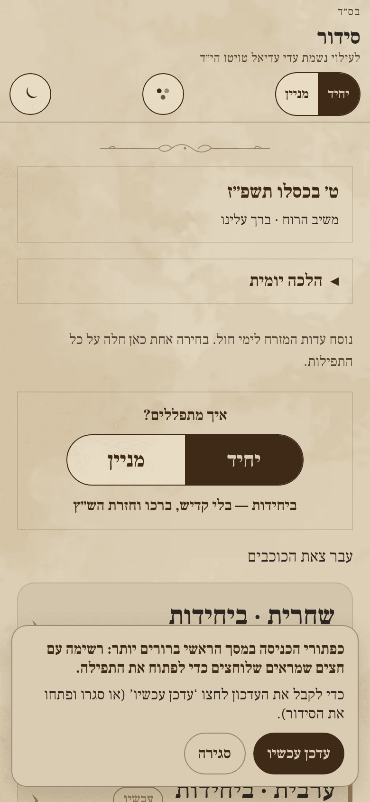  <b>⬆️ עדכונים בלחיצה</b> כשיוצאת גרסה חדשה מופיעה הודעה קצרה עם מה השתנה וכפתור עדכן עכשיו. בלי חנות ובלי הורדות.</td><td width="33%" align="center" valign="top">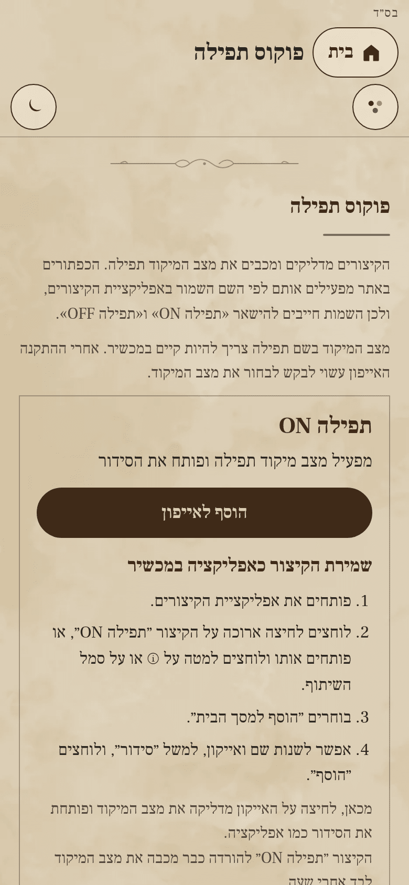  <b>🎯 מצב תפילה</b> קיצור דרך שמפעיל "תפילה ON" ומשתיק את הטלפון, ו"תפילה OFF" שמחזיר הכול.</td><td width="33%" align="center" valign="top">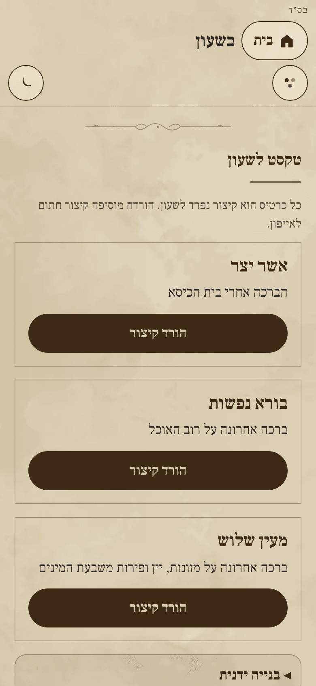  <b>⌚ ברכות על שעון Apple Watch</b> קיצורי טקסט לברכות, שנפתחים ישר על פרק היד.</td></tr>
</table>

## 🕯️ נעילת שבת ויום טוב

לפי לוח השנה הישראלי, הסידור **ננעל לפני השקיעה** (הדלקת נרות, 20 דקות לפני) ונפתח בצאת השבת לפי רבנו תם. בלי לחשוב על זה.

---

## 🖼️ גלריה

<table dir="rtl" align="center"><tr><td align="center" valign="top" width="25%"> <b>מסך ראשי</b></td><td align="center" valign="top" width="25%"> <b>מצב כהה</b></td><td align="center" valign="top" width="25%">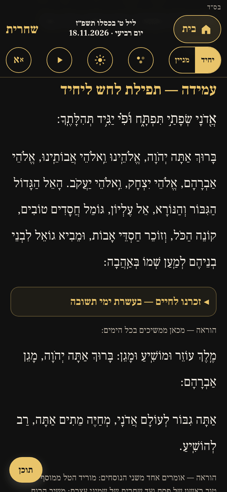 <b>שחרית, מצב כהה</b></td><td align="center" valign="top" width="25%">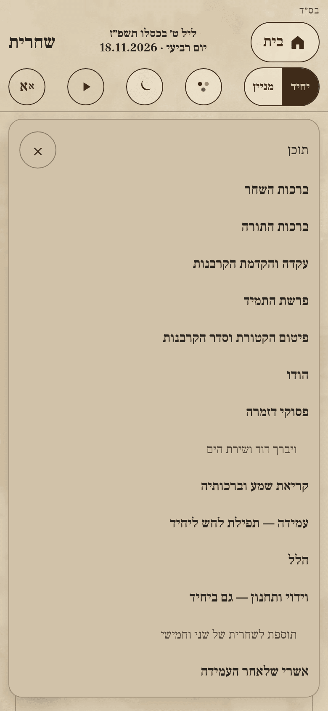 <b>תוכן עניינים</b></td></tr></table>
<table dir="rtl" align="center"><tr><td align="center" valign="top" width="25%">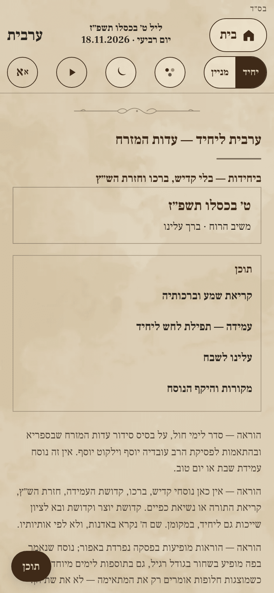 <b>ערבית</b></td><td align="center" valign="top" width="25%">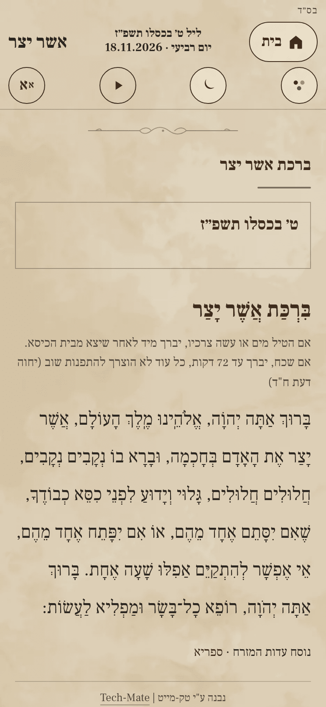 <b>אשר יצר</b></td><td align="center" valign="top" width="25%"> <b>מצב מניין</b></td><td align="center" valign="top" width="25%"> <b>עדכון</b></td></tr></table>

---

## 📲 איך מתקינים

1. פותחים את **https://idanatwork.github.io/LPs/tefila/** בדפדפן.
2. **אייפון:** שיתוף ← "הוסף למסך הבית". **אנדרואיד:** תפריט ← "התקן אפליקציה".
3. זהו. הסידור נפתח כמו אפליקציה, גם בלי אינטרנט.

---

## 🧱 מאחורי הקלעים

- אתר סטטי: HTML, CSS ו־JavaScript. בלי שרת, בלי מעקב, בלי פרסומות.
- התראות דחיפה דרך Cloudflare Worker (`workers/tefila-push-worker`).
- נשלח לאוויר דרך GitHub Pages.
- **מקורות:** נוסח סידור עדות המזרח, וילקוט יוסף לניסוחי ההלכה. הרשימה המלאה בעמוד שחרית, בפרק "מקורות והיקף הנוסח".

---

<b>לעילוי נשמת עדי עדיאל טויטו הי״ד</b> יהי זכרה ברוך

